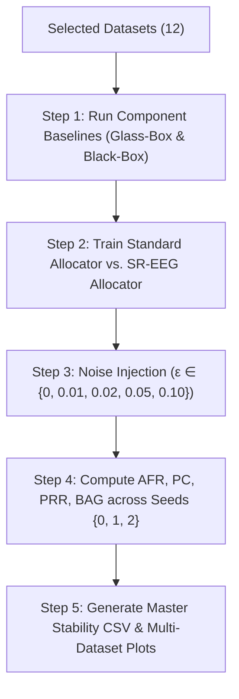
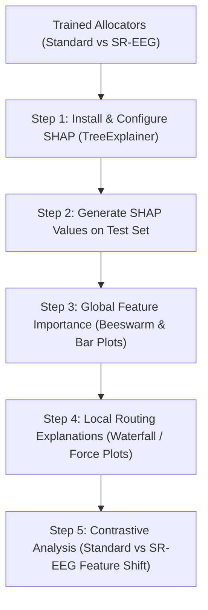

# Comprehensive Execution Plan: Gap 3 (Perturbation Stability) & Gap 6 (Meta-Explainability via SHAP)

**Project:** Learning Performance Maximizing Ensembles with Explainability Guarantees (EEG)  
**Objective:** End-to-end implementation, evaluation, and documentation of:
1. **Gap 3 (Primary):** Perturbation Stability & Stability-Robust Allocator (SR-EEG) across 10–12 curated small-to-medium datasets.
2. **Gap 6 (Secondary):** Meta-Explainability ("Explaining the Explainer") using TreeSHAP on the EEG Allocator, contrasting standard vs. noise-robust routing decisions.

---

## 1. Selected Datasets (Sweet Spot: 10–12 Small-to-Medium Datasets)

Out of the 35 benchmark datasets in the repository, we avoid the massive datasets (Covertype with 566k, Higgs with 940k, NYCTaxi with 581k) to prevent multi-hour bottlenecks and memory exhaustion while ensuring robust statistical diversity.

### 1.1 Classification Datasets (8 Datasets)
| # | Dataset | Samples | Features | Domain | Why Selected |
|---|---|---|---|---|---|
| 1 | **Wine** | 2,554 | 11 | Chemical / Quality | Fast baseline, existing test bench |
| 2 | **Phoneme** | 3,172 | 5 | Speech Recognition | High noise sensitivity, clean baseline |
| 3 | **KDDIPUMS** | 5,188 | 60 | Census / Demographic | High-dimensional categorical & continuous mix |
| 4 | **EyeMovements**| 7,608 | 20 | Neuroscience / Sensor | Temporal/continuous sensor signals |
| 5 | **Pol** | 10,082 | 26 | Telecommunications | Moderate size, balanced distribution |
| 6 | **Bank** | 10,578 | 16 | Marketing / Finance | Tabular financial data, real-world relevance |
| 7 | **MagicTelescope**| 13,376 | 10 | High Energy Physics | Clean numeric features, standard ML benchmark |
| 8 | **Credit** | 16,714 | 10 | Financial Risk | Class imbalance handling, sensitive boundaries |

### 1.2 Regression Datasets (4 Datasets)
| # | Dataset | Samples | Features | Domain | Why Selected |
|---|---|---|---|---|---|
| 9 | **Wine_R** | 6,497 | 11 | Physicochemical | Direct regression analog to Wine classification |
| 10 | **CPU_R** | 8,192 | 12 | Computer Hardware | Low sample variance, clear functional relationships |
| 11 | **Isolet_R** | 7,797 | 617 | Audio / Speech | Very high-dimensional tabular feature space |
| 12 | **BrazilianHouses_R** | 10,692 | 12 | Real Estate Economics | Real-world price prediction with skew |

> **Total Scope:** 12 datasets (8 classification + 4 regression), ~100k total samples across tabular domains.

---

## 2. Phase 1: Implementation of Gap 3 (Noise Perturbation & SR-EEG)

### 2.1 Theoretical Motivation
The original EEG allocator $A(x) \in [0, 1]$ decides whether observation $x$ is routed to the Glass-Box (interpretable model $h_g$) or Black-Box (high-performance model $h_b$) to satisfy budget $q$.
- **Problem:** If a sample $x$ is slightly perturbed by observational or sensor noise $\tilde{x} = x + \delta$ ($\|\delta\| \le \epsilon$), will the allocator flip its routing decision ($A(x) \neq A(\tilde{x})$)?
- **Hypothesis:** The standard EEG allocator suffers from high **Allocation Flip Rate (AFR)** near decision boundaries. A **Stability-Robust Allocator (SR-EEG)** trained with data perturbation augmentation and regularized tree depth will dramatically reduce AFR while preserving accuracy and explainability budget guarantees.

### 2.2 Metrics for Evaluation
For each perturbation magnitude $\epsilon \in \{0.00, 0.01, 0.02, 0.05, 0.10\}$ across explainability budgets $q \in \{0.1, 0.3, 0.5, 0.7, 0.9\}$:
1. **Allocation Flip Rate (AFR):** Percentage of test samples whose routing switches between clean and noisy inputs:
   $$\text{AFR}(\epsilon) = \frac{1}{N} \sum_{i=1}^N \mathbb{I}\left( \hat{A}(x_i) \neq \hat{A}(x_i + \delta_i) \right)$$
2. **Prediction Consistency (PC):** Percentage of final ensemble outputs that remain identical under perturbation:
   $$\text{PC}(\epsilon) = \frac{1}{N} \sum_{i=1}^N \mathbb{I}\left( \hat{y}(x_i) = \hat{y}(x_i + \delta_i) \right)$$
3. **Performance Retention Ratio (PRR):** AUC / Accuracy retention under noise:
   $$\text{PRR}(\epsilon) = \frac{\text{Metric}(h_{\text{ens}}, \tilde{X})}{\text{Metric}(h_{\text{ens}}, X)}$$
4. **Budget Adherence Gap (BAG):** $| \bar{A}(\tilde{X}) - q |$ to verify that noise does not break the user-defined explainability budget.

### 2.3 Step-by-Step Execution Workflow

#### Detailed Tasks:
- [ ] **Task 3.1: Environment & Baseline Verification**
  - Verify Python dependencies (`numpy`, `pandas`, `scikit-learn`, `torch`, `matplotlib`, `seaborn`).
  - Run a smoke test on `Wine` and `Phoneme` with existing `experiment_stability.py` to confirm baseline output integrity.
- [ ] **Task 3.2: Generalize and Extend `experiment_stability.py`**
  - Support command-line `--dataset_name` dynamically.
  - Implement regression support:
    - Extend perturbation loop to handle continuous targets using MSE / RMSE loss differences.
    - Define continuous prediction consistency (e.g., $|\hat{y} - \hat{y}_{\text{noisy}}| \le \tau \cdot \sigma_y$).
  - Allow batch execution via a script runner (`run_all_stability.py`).
- [ ] **Task 3.3: Batch Execution Across All 12 Datasets**
  - Run experiments across seeds $0, 1, 2$ to capture error bars / standard deviations.
  - Store results systematically in `results/stability/<dataset_name>/summary.csv`.
- [ ] **Task 3.4: Cross-Dataset Aggregation & Plotting**
  - Plot **AFR vs. $\epsilon$** curve comparing Standard EEG vs. SR-EEG across all 12 datasets.
  - Plot **Performance Trade-off** (Ensemble Accuracy vs. Robustness).
  - Export a consolidated summary table formatted for research paper publication.

---

## 3. Phase 2: Implementation of Gap 6 (Meta-Explainability via SHAP)

### 3.1 Theoretical Motivation
- **The Core Paradox:** The entire goal of EEG is to route samples to a Glass-Box model for explainability. But **the Allocator itself is a complex Gradient Boosting Regressor (GBR)**.
- **The Research Question:** *"Who explains the Explainer?"* What factors drive the allocator's decision to classify a sample as "easy" (route to Glass-Box) or "hard" (route to Black-Box)?
- **Hypothesis & Investigations:**
  1. **Feature Attribution:** Which input features $x_j$ have the greatest impact on routing?
  2. **Model Confidence vs. Domain Features:** Does the allocator route based on intrinsic feature values (e.g., extreme age, outlier income) or based on component disagreement?
  3. **Robustness Shift (Gap 3 + Gap 6 Synergy):** How does SR-EEG change the allocator's decision logic? Does noise-robust training force the allocator to ignore spurious, noise-sensitive features?

### 3.2 Step-by-Step Execution Workflow

#### Detailed Tasks:
- [ ] **Task 6.1: Setup `shap` & Allocator Interface**
  - Verify `shap` installation (`pip install shap`).
  - Create dedicated module `analyze_allocator_shap.py`.
  - Wrap the trained GBR Allocator with `shap.TreeExplainer`.
- [ ] **Task 6.2: Global Meta-Explanations**
  - Generate SHAP Summary Beeswarm plots showing:
    - High feature values $\rightarrow$ positive impact on routing to Black-Box.
    - Low feature values $\rightarrow$ routing to Glass-Box.
  - Compute Mean Absolute SHAP values across features to rank the top routing drivers per dataset.
- [ ] **Task 6.3: Local Case Studies ("Why was this sample routed to Black-Box?")**
  - Pick 3 canonical test instances per dataset:
    - Case A: High-confidence Glass-Box assignment ($A(x) \ll \tau_q$).
    - Case B: Boundary contention ($A(x) \approx \tau_q$).
    - Case C: High-confidence Black-Box assignment ($A(x) \gg \tau_q$).
  - Generate Waterfall plots highlighting the exact marginal contribution of each feature to the routing decision.
- [ ] **Task 6.4: The SR-EEG vs. Standard EEG Attribution Shift**
  - Compare the top-5 feature SHAP weights in Standard Allocator vs. SR-EEG Allocator.
  - Test if SR-EEG flattens the attribution of high-variance, noise-sensitive features in favor of robust, invariant features.
- [ ] **Task 6.5: Export Figures & Meta-Explainability Report**
  - Save all plots to `results/shap/<dataset_name>/`.
  - Create markdown synthesis documenting cross-dataset patterns.

---

## 4. Deliverables Checklist

| Artifact / Deliverable | Target Location | Description |
|---|---|---|
| **Phase 1 Plan Document** | `EXECUTION_PLAN_GAP3_GAP6.md` | Detailed roadmap for Gap 3 and Gap 6 |
| **Modular Stability Engine** | `experiment_stability.py` / `run_all_stability.py` | CLI-enabled, multi-dataset, regression-capable stability benchmark |
| **Stability Benchmark Data** | `results/stability_master.csv` | Full metric results across 12 datasets, 5 noise levels, 3 seeds |
| **Stability Visualizations** | `figures/stability_cross_dataset.png` | Publication-ready multi-panel stability curves |
| **SHAP Allocator Analyzer** | `analyze_allocator_shap.py` | Script for TreeExplainer computation and plot generation |
| **SHAP Visualizations** | `figures/shap/<dataset>/` | Beeswarm, waterfall, and shift comparison plots |
| **Final Synthesis Report** | `FINAL_PHASE2_RESEARCH_FINDINGS.md` | Comprehensive research paper style writeup with tables, figures, and insights |

---

## 5. Execution Timeline & Next Action

1. **Step 1:** Confirm the 12 selected datasets and metric definitions.
2. **Step 2:** Execute Gap 3 smoke-test on `Wine` and `Phoneme`, then launch batch runs on all selected datasets.
3. **Step 3:** Implement and execute Gap 6 SHAP analysis on the resulting allocators.
4. **Step 4:** Generate all final figures and wrap up the report.
