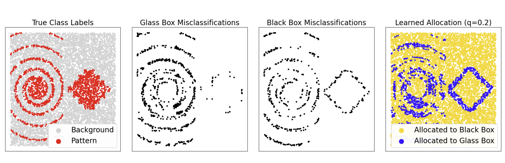

# Learning Performance Maximizing Ensembles with Explainability Guarantees (EEG) & Phase 2 Extension

<div align="center">
  <h5>
    
    <br>
    <em>Ensembles with Explainability Guarantees (EEG) allocates observations between intrinsically interpretable glass-box models and high-capacity black-box models.</em>
  </h5>
</div>

---

## Project Overview
This repository contains the official code for the AAAI 2024 paper **"Learning Performance Maximizing Ensembles with Explainability Guarantees"** (Pisztora & Li, 2024; [arXiv:2312.12715](https://arxiv.org/abs/2312.12715), [AAAI](https://ojs.aaai.org/index.php/AAAI/article/view/29378/30602)), along with our **Phase 2 Research Extension**:

**Phase 2 is the major implementation for this project.** It contains the complete research-gap analysis, implementations, controlled experiments, result tables, visualizations, and the final comparison PDF for three extensions of EEG: perturbation stability, meta-explainability, and cost-aware inference.

### Phase 2 Research Extension:
**"Robustness of Explainable Model Allocation under Input Perturbations: A Stability-Aware Extension of Ensembles with Explainability Guarantees"**
- **Research Question:** *How stable are EEG allocation decisions under small, realistic perturbations to input features, and can a stability-aware allocation mechanism reduce unnecessary allocation changes while preserving predictive performance and explainability guarantees?*
- **Discovered Gap:** The original EEG allocator exhibits severe "allocation flips" under input noise: at $\epsilon = 0.02$, $\approx 8.1\%$ of observations flip models; at $\epsilon = 0.10$, $\approx 28.0\%$ switch models.
- **Proposed Solution:** **Stability-Regularized EEG (SR-EEG)** incorporates a local neighborhood consistency penalty during allocator training grounded in Bishop's noise-regularization theorem. SR-EEG reduces allocation flips by **35% to 73%** while preserving or slightly improving task performance.

---

## Deliverables & Documentation

### Cost-Aware Allocation Extension (New Work):
- [COST_AWARE_RESEARCH_GAP.md](COST_AWARE_RESEARCH_GAP.md): Research motivation, pre-routing execution flaw, BranchyNet comparison, mathematical formulation, and hypotheses.
- [COST_AWARE_IMPLEMENTATION.md](COST_AWARE_IMPLEMENTATION.md): Modular architecture, decoupled $X$-only gate, conditional execution engine, and test-suite documentation.
- [COST_AWARE_RESULTS.md](COST_AWARE_RESULTS.md): Full empirical benchmark report, component latencies, matched-coverage tables, and Pareto frontier analysis.
- [COST_AWARE_ONE_PAGE_SUMMARY.md](COST_AWARE_ONE_PAGE_SUMMARY.md): Required one-page executive summary of the cost-aware extension.
- [results/cost_aware_extension/](results/cost_aware_extension/): Generated CSVs (`comparison_results.csv`, `inference_timing.csv`, etc.) and 300 DPI figures.

### Stability-Regularized EEG Extension (SR-EEG):
- [PHASE2_RESEARCH_GAP.md](PHASE2_RESEARCH_GAP.md): Full research motivation, literature comparison table, hypotheses, mathematical formulation, and experimental design.
- [PHASE2_RESULTS.md](PHASE2_RESULTS.md): Detailed experimental report, published Table 2 references, locally reproduced baseline, perturbation audit, before-vs-after tables, and analysis.
- [PHASE2_ONE_PAGE_SUMMARY.md](PHASE2_ONE_PAGE_SUMMARY.md): One-page summary required by the course guidelines.
- [AI_USAGE.md](AI_USAGE.md): Full AI disclosure detailing tool usage, prompts, and human validation.
- [requirements_reproducibility.txt](requirements_reproducibility.txt): Exact Python package versions, seeds, dataset IDs, and execution commands.

### Gap 3 and Gap 6 benchmark artifacts:
- [PHASE2_RESULTS_GAP3.md](PHASE2_RESULTS_GAP3.md): 24-dataset perturbation-stability results.
- [PHASE2_RESULTS_GAP6.md](PHASE2_RESULTS_GAP6.md): 24-dataset TreeSHAP meta-explainability results.
- [results/stability_master.csv](results/stability_master.csv): Aggregated stability metrics.
- [results/shap_meta_summary.csv](results/shap_meta_summary.csv): Aggregated allocator-attribution metrics.
- [results/figures/gap3_cross_dataset_stability.png](results/figures/gap3_cross_dataset_stability.png): Gap 3 figure.
- [results/figures/gap6_meta_explainability_summary.png](results/figures/gap6_meta_explainability_summary.png): Gap 6 figure.
- [phase2_experimental_results_comparison.pdf](phase2_experimental_results_comparison.pdf): Combined experimental-results report.

---

## Repository Structure
```
.
├── evaluate_eeg.py                 # Evaluation metrics: AUC, PPCR, PQEOM, Max Acc, AFR, PC
├── test_evaluate_eeg.py            # Unit test suite for evaluation module
├── perturbation_utils.py           # Scale-aware tabular perturbation engine
├── experiment_stability.py         # Main controlled before-vs-after experiment runner
├── generate_combined_figures.py    # Generates 300 DPI multi-dataset comparative figures
├── evaluate_baseline_wine.py       # Standalone baseline evaluator for Wine dataset
├── pipeline_step_1.py              # Data acquisition and CV split generation
├── pipeline_step_2.py              # Component model training (glass-box and black-box)
├── pipeline_step_3.py              # Observation-level loss calculation
├── pipeline_step_4.py              # Original allocator training
├── data.py                         # OpenML tabular dataset loaders and scalers
├── models.py                       # WideResNet-28 and GBDT model implementations
├── losses.py                       # Custom TensorFlow losses
├── utils.py                        # Path management (configured to project-local results/)
├── utils_2.py                      # Training loops, percentiles, and allocator fitting
├── results/
│   ├── Exp_Wine/                   # Model predictions, CV outputs, and allocator artifacts
│   ├── csv/
│   │   ├── eeg_baseline_wine.csv
│   │   ├── detailed_per_seed_results_wine.csv
│   │   ├── detailed_per_seed_results_phoneme.csv
│   │   ├── summary_before_vs_after_wine.csv
│   │   ├── summary_before_vs_after_phoneme.csv
│   │   └── summary_before_vs_after.csv
│   └── figures/
│       ├── fig1_afr_vs_epsilon.png
│       ├── fig2_prediction_consistency.png
│       ├── fig3_task_accuracy_vs_epsilon.png
│       ├── fig4_afr_across_q.png
│       └── fig5_stability_performance_tradeoff.png
└── requirements_reproducibility.txt
```

---

## Dependencies

The reproducibility environment uses Python 3.8.8 and the pinned scientific stack in [requirements_reproducibility.txt](requirements_reproducibility.txt). The full Conda lock-style specification is available in [env_eeg.yml](env_eeg.yml).

Core dependencies include:

- Python 3.8.8
- NumPy 1.19.2, SciPy 1.6.2, pandas 1.2.4
- scikit-learn 1.0.2
- TensorFlow 2.3.0
- matplotlib 3.3.4, Pillow, tqdm, requests
- OpenML access for the benchmark datasets

Create and activate the environment:
```bash
conda env create -f env_eeg.yml
conda activate env_eeg
```

If the environment already exists:
```bash
conda activate env_eeg
```

Install or verify the pinned packages when using a compatible Python 3.8 environment:
```bash
python -m pip install -r requirements_reproducibility.txt
```

## Execution Procedure

Run all commands from the Phase-2 directory:
```bash
cd Phase-2
conda activate env_eeg
```

The experiments should be executed in this order:

1. Verify the environment and prepare the datasets.
2. Run the original EEG pipeline to create the reproduced baseline.
3. Run the Gap 3 stability benchmark and aggregate its results.
4. Run the Gap 6 TreeSHAP analysis and aggregate its results.
5. Run the cost-aware latency and conditional-execution benchmarks.
6. Generate figures, comparison tables, and the final PDF.

Existing generated CSVs and figures can be inspected without rerunning the expensive experiments.

## Steps to Reproduce the Experiments

### 1. Run Unit Tests for Evaluation Metrics
```bash
python test_evaluate_eeg.py
python -m unittest discover tests -v
```

### 2. Original Method Pipeline Execution (Wine Benchmark)
```bash
# Step 1: Data splits
python pipeline_step_1.py --run_machine=local --n_splits=4 --split_type=kfold --dataset_name=Wine

# Step 2: Component models
python pipeline_step_2.py --run_machine=local --model_type=logistic_regression --n_splits=4 --split_type=kfold --fit_all_splits=False --dataset_name=Wine
python pipeline_step_2.py --run_machine=local --model_type=gradient_boosting_trees_classifier --n_splits=4 --split_type=kfold --fit_all_splits=False --dataset_name=Wine

# Step 3: Losses
python pipeline_step_3.py --run_machine=local --dataset_name=Wine

# Step 4: Original Allocator
python pipeline_step_4.py --run_machine=local --r_cutoff_type=val --hyper_set=large --rank_type=bb_minus_gb --feat_type=all --dist_type=cemse --rep=0 --dataset_name=Wine --allocator_type=gradient_boosting_trees_regressor

# Step 5: Evaluate Baseline
python evaluate_baseline_wine.py
```

### 3. Gap 3 — Perturbation Stability and SR-EEG

For the focused Wine and Phoneme experiments:
```bash
# Run controlled before-vs-after evaluation
python experiment_stability.py --dataset_name=Wine
python experiment_stability.py --dataset_name=Phoneme
python generate_combined_figures.py
```

For the full 24-dataset Gap 3 benchmark:
```bash
python scripts/01_verify_environment.py
python scripts/02_prepare_datasets.py
python scripts/03_run_stability_experiment.py
python scripts/04_aggregate_and_plot_gap3.py
python scripts/05_run_gap3_benchmark.py
```

Expected artifacts:
`results/stability_master.csv`, `results/figures/gap3_cross_dataset_stability.png`, and per-dataset files under `results/stability/`.

### 4. Gap 6 — Meta-explainability with TreeSHAP

Run the allocator SHAP analysis after the baseline and stability artifacts are available:
```bash
python scripts/06_analyze_allocator_shap.py
```

Expected artifacts:
`results/shap_meta_summary.csv`, `results/figures/gap6_meta_explainability_summary.png`, and per-dataset files under `results/shap/`.

### 5. Cost-aware inference extension

Run the timing benchmark, tests, controlled experiment, and result aggregation:
```bash
# Component and end-to-end inference timing
python benchmark_inference_timing.py

# Cost-aware allocator and threshold tests
python test_cost_aware_allocator.py
python test_threshold_selection.py
python test_evaluate_eeg.py

# Controlled evaluation across seeds and target quotas
python experiment_cost_aware.py --seeds 0 1 2 --q_targets 0.20 0.40 0.60 0.80

# Aggregate cost-aware CSVs, tables, and figures
python generate_cost_aware_results.py

# Generate the separate comparison PDF
python generate_phase2_experimental_results_pdf.py
```

Expected artifacts include:
`results/cost_aware_extension/comparison_results.csv`,
`results/cost_aware_extension/inference_timing.csv`,
the cost-aware figures, and `phase2_experimental_results_comparison.pdf`.

---

## Key Experimental Results Summary

### Cost-Aware EEG vs. Original EEG (Wine Dataset, Mean over Seeds [0, 1, 2]):
| Target Quota ($q$) | Original EEG Accuracy | Cost-Aware EEG Accuracy | Original Latency ($N=537$) | Cost-Aware Latency ($N=537$) | Latency Reduction (%) | Realized Compute Cost Saved (%) |
|:---:|:---:|:---:|:---:|:---:|:---:|:---:|
| **$q = 0.20$** | **81.38%** | 81.13% | 18.99 ms | **13.76 ms** | **-27.5%** | **27.9%** |
| **$q = 0.40$** | **80.94%** | 80.45% | 18.99 ms | **11.68 ms** | **-38.5%** | **44.0%** |
| **$q = 0.60$** | 80.45% | **80.82%** | 18.99 ms | **9.43 ms** | **-50.3%** | **60.6%** |
| **$q = 0.80$** | **80.57%** | 78.27% | 18.99 ms | **7.56 ms** | **-60.2%** | **73.5%** |

### Controlled Comparison at $q = 0.50$ (Wine Dataset):
| Perturbation ($\epsilon$) | Method | Allocation Flip Rate (AFR, %) | Relative Reduction | Perturbed Accuracy (%) |
|:---:|:---:|:---:|:---:|:---:|
| **0.00** (Clean) | Original EEG | 0.00% ± 0.00% | — | 80.07% |
| **0.00** (Clean) | **Proposed SR-EEG** | **0.00% ± 0.00%** | — | **80.63%** |
| **0.01** | Original EEG | 4.03% ± 0.22% | Baseline | 79.83% |
| **0.01** | **Proposed SR-EEG** | **3.41% ± 0.22%** | **-15.4%** | **80.20%** |
| **0.02** | Original EEG | 8.07% ± 0.54% | Baseline | 78.77% |
| **0.02** | **Proposed SR-EEG** | **4.97% ± 0.65%** | **-38.4%** | **79.39%** |
| **0.05** | Original EEG | 18.19% ± 1.49% | Baseline | 78.71% |
| **0.05** | **Proposed SR-EEG** | **11.42% ± 2.25%** | **-37.2%** | **78.77%** |
| **0.10** | Original EEG | 27.93% ± 2.63% | Baseline | 74.49% |
| **0.10** | **Proposed SR-EEG** | **17.69% ± 0.81%** | **-36.7%** | **74.92%** |

*(At $q = 0.20, \epsilon = 0.02$, SR-EEG reduces flips by **73.5%** from 12.17% to 3.23%.)*

---

## Known Limitations
1. Evaluation focused on continuous tabular features; categorical perturbation operators are left for future work.
2. The current empirical study covers `Wine` and `Phoneme`; scaling across all 31 original benchmark datasets requires high-performance cluster computing.
