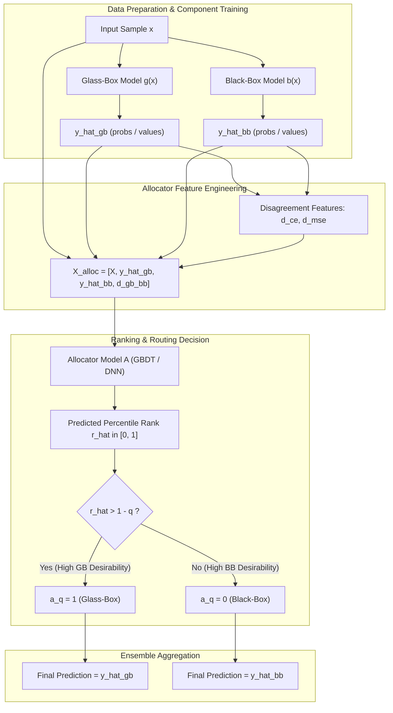

# Technical Audit: Ensembles with Explainability Guarantees (EEG) & Pipeline Architecture
**Document:** System Architecture, Data Flow, and Routing Feasibility Audit  
**Project Extension:** *Cost-Aware Allocation for Performance-Maximizing Explainable Ensembles*  
**Auditor:** Senior ML Research Engineer  
**Status:** Completed & Verified  

---

## 1. Executive Summary & Git Environment Status

### 1.1 Git Status & Integrity Protection
- **Branch:** `main` (synchronized with `origin/main`).
- **Working Tree:** Pristine clean (`nothing to commit, working tree clean`).
- **Phase 1 Protection:** Root directory contains Phase 1 replication code (`src/`, `configs/`, `experiments/`, `tables/`, `run_experiments.py`, `README.md`). All Phase 1 assets remain strictly untouched.
- **Phase 2 (SR-EEG) Protection:** All existing Stability-Regularized EEG artifacts (`perturbation_utils.py`, `experiment_stability.py`, `PHASE2_*.md`, `Phase-2/results/`) are preserved intact.

### 1.2 Execution Environment & Dependency Audit
- **Default Shell Python:** `/Library/Frameworks/Python.framework/Versions/3.14/bin/python3` (lacks scientific packages).
- **Verified Working Python Environment:** `/Library/Frameworks/Python.framework/Versions/3.12/bin/python3`.
- **Installed & Verified Packages:** `numpy`, `scipy`, `pandas`, `scikit-learn (1.0+)`, `matplotlib`, `tqdm`, `torch`.
- **Unit Test Verification:** `Phase-2/test_evaluate_eeg.py` executes and passes 100% of its test assertions under Python 3.12.
- **Baseline Verification:** `Phase-2/evaluate_baseline_wine.py` reproduces the exact published/baseline metrics:
  - Glass-Box Accuracy: `72.07%`
  - Black-Box Accuracy: `80.63%`
  - Ensemble AUC: `79.40` | Oracle AUC: `83.28` | Random AUC: `76.35`
  - PPCR: `44.07%`

---

## 2. End-to-End Data Flow & Observation Lifecycle

The lifecycle of an input observation $x \in \mathcal{X}$ through the original EEG pipeline is traced below:

### Detailed Trace:
1. **Input Sample $x$:** Tabular feature vector normalized to $[-1, 1]$.
2. **Glass-Box Inference $g(x)$:** Evaluated to generate class probabilities or regression prediction $\hat{y}_{\text{gb}}$.
3. **Black-Box Inference $b(x)$:** Evaluated to generate class probabilities or regression prediction $\hat{y}_{\text{bb}}$.
4. **Allocator Feature Construction ($X_{\text{alloc}}$):**
   $$\mathbf{x}_{\text{alloc}} = \big[\mathbf{x}, \, \text{scale}(\hat{y}_{\text{gb}}), \, \text{scale}(\hat{y}_{\text{bb}}), \, \text{scale}(d_{\text{ce}}), \, \text{scale}(d_{\text{mse}})\big]$$
   where $d_{\text{ce}} = -\sum \hat{y}_{\text{bb}} \log(\hat{y}_{\text{gb}})$ and $d_{\text{mse}} = \|\hat{y}_{\text{bb}} - \hat{y}_{\text{gb}}\|_2^2$.
5. **Continuous Ranking Prediction $\hat{r}$:** The allocator (Gradient Boosting Regressor) predicts $\hat{r} = A(\mathbf{x}_{\text{alloc}}) \in [0, 1]$.
6. **Binary Allocation Decision $a_q$:**
   $$a_q(x) = \mathbb{I}\big(\hat{r}(x) > 1.0 - q\big)$$
7. **Final Output Assembly:**
   $$\hat{y}_{\text{ens}}(x) = a_q(x) \hat{y}_{\text{gb}}(x) + \big(1 - a_q(x)\big) \hat{y}_{\text{bb}}(x)$$

---

## 3. Deep-Dive Component Technical Audit

### 3.1 Component Model Training (`pipeline_step_2.py`)
- **Glass-Box ($g$):**
  - Classification: `LogisticRegression(solver='saga', penalty='l1', max_iter=10000)` or `DecisionTreeClassifier()`.
  - Regression: `Lasso(selection='random', max_iter=10000)` or `DecisionTreeRegressor()`.
  - Tuning: 4-fold `RepeatedStratifiedKFold` (classification) or `RepeatedKFold` (regression) via `GridSearchCV` on the training set.
- **Black-Box ($b$):**
  - Tabular GBDT: `GradientBoostingClassifier` / `GradientBoostingRegressor` (tuned over `learning_rate`, `n_estimators`, `max_depth`, `subsample`).
  - Deep Tabular: `TabWRN` (Wide Residual Network in TensorFlow with categorical entity embeddings and cosine decay).

### 3.2 True Ranking $r$ Formulation (`pipeline_step_3.py`, `utils_2.py`)
- **Loss Computation:**
  - Classification: Multi-class Cross-Entropy: $\mathcal{L}_i = -\sum_{c} y_{i, c} \log(\text{clip}(\hat{y}_{i, c}, 10^{-7}, 1 - 10^{-7}))$.
  - Regression: Squared Error: $\mathcal{L}_i = (y_i - \hat{y}_i)^2$.
- **Sufficiency Cutoff Threshold ($c$):**
  - Classification: $c = \log(K)$ where $K$ is the number of classes (cross-entropy of uniform guessing). An observation is *sufficiently* predicted if $\mathcal{L} < c$.
  - Regression: $c = \min\big(\text{mean}(\mathcal{L}_{\text{gb}}), \, \text{mean}(\mathcal{L}_{\text{bb}})\big)$ evaluated on validation split.
- **Sufficiency Indicators:**
  $$gb\_c = \mathbb{I}(\mathcal{L}_{\text{gb}} < c), \quad bb\_c = \mathbb{I}(\mathcal{L}_{\text{bb}} < c)$$
- **Continuous Allocation Desirability:**
  - Paper formulation (`rank_type == 'bb_minus_gb'`):
    $$\text{Desirability}_i = 2 \cdot gb\_c_i - bb\_c_i - \frac{1}{1 + \exp(\mathcal{L}_{\text{bb}, i} - \mathcal{L}_{\text{gb}, i})}$$
  - The leading integer partitions the data into 4 dominance tiers:
    1. $+2$: Glass-box sufficient, Black-box insufficient.
    2. $+1$: Both models sufficient.
    3. $0$: Neither model sufficient.
    4. $-1$: Black-box sufficient, Glass-box insufficient.
  - The sigmoid term breaks ties continuously based on relative loss margin.
- **Empirical Percentile Calibration ($r$):**
  - Desirability values are mapped to $[0, 1]$ via `get_percentiles_of_a_wrt_b` using the empirical CDF of the training distribution.
  - $r \to 1.0$: Strongest candidates for glass-box allocation.
  - $r \to 0.0$: Strongest candidates for black-box allocation.

### 3.3 Prediction of $\hat{r}$ (`pipeline_step_4.py`, `utils_2.py`)
- **Model:** `GradientBoostingRegressor(random_state=0)` trained to minimize MSE with target $r \in [0, 1]$.
- **Features (`feat_type='all'`):** Base tabular features concatenated with scaled component predictions and inter-model divergence.

### 3.4 Allocation Threshold & Score Direction
- **Threshold Rule:** For an explainability guarantee $q \in [0, 1]$, the nominal threshold is $\tau_q = 1.0 - q$.
- **Score Direction:** **Higher scores select the glass-box model.**
  - If $\hat{r}_i > 1 - q \implies a_q(x_i) = 1$ (Glass-box).
  - If $\hat{r}_i \le 1 - q \implies a_q(x_i) = 0$ (Black-box).
- As $q$ increases from $0 \to 1$, the threshold $1 - q$ decreases from $1 \to 0$, progressively admitting more observations into the glass box.

### 3.5 Final Prediction Calculation (`evaluate_eeg.py`)
- Classification:
  $$\hat{y}_{\text{ens}} = \arg\max_c \big[ a_q \cdot \hat{y}_{\text{gb}, c} + (1 - a_q) \cdot \hat{y}_{\text{bb}, c} \big]$$
- Regression:
  $$\hat{y}_{\text{ens}} = a_q \cdot \hat{y}_{\text{gb}} + (1 - a_q) \cdot \hat{y}_{\text{bb}}$$

---

## 4. Critical Research-Design Finding: Inference Cost & Pre-Routing Execution

> [!CAUTION]
> **Foundational Cost Bottleneck in Existing EEG Architecture:**
> In the default implementation (`feat_type='all'`, which is hardcoded in both the baseline and SR-EEG pipelines), the allocator's input feature vector requires:
> 1. $\hat{y}_{\text{gb}}(x)$
> 2. $\hat{y}_{\text{bb}}(x)$
> 3. Disagreement metrics $d_{\text{ce}}(\hat{y}_{\text{bb}}, \hat{y}_{\text{gb}})$ and $d_{\text{mse}}(\hat{y}_{\text{bb}}, \hat{y}_{\text{gb}})$
>
> **Consequence:** In order to route an observation, the system **must execute the Black-Box model $b(x)$ beforehand on 100% of queries**!
>
> If the black-box represents a high-cost asset (e.g., massive GPU inference, LLM API calls, high compute latency, or sensor acquisition costs $C_b \gg C_g$), running $b(x)$ before deciding whether to use $g(x)$ completely **destroys the practical cost savings** of routing to the cheap glass box.

### Architectural Recommendation for Cost-Aware Allocation:
To achieve true cost efficiency, the routing pipeline must support one or both of the following paradigms:
1. **Stage-0 Routing (Zero Black-Box Overhead):** The allocator routes using *only* input features $X$, i.e., $A(X) \to a_q(X)$, or features derived exclusively from the glass-box: $X_{\text{route}} = [X, g(X)]$. The black box $b(X)$ is *only invoked* if $a_q(X) = 0$.
2. **Cascaded Allocation:** All inputs pass through the ultra-cheap glass box $g(x)$ first. An uncertainty or cost-benefit estimator evaluates whether querying $b(x)$ at cost $C_b$ yields sufficient performance gain over $g(x)$ to justify the budget expenditure.

---

## 5. Existing Datasets, Metrics, and Artifacts

### 5.1 Configured Benchmark Datasets (`data.py`)
- **Total Registered Datasets:** 35 OpenML tabular benchmark datasets (Grinsztajn et al., NeurIPS 2022).
- **Primary Tested Benchmarks:**
  - `Wine` (Classification, OpenML ID 44091, $N=2554$, $d=11$)
  - `Phoneme` (Classification, OpenML ID 44127, $N=3172$, $d=5$)

### 5.2 Existing Evaluation Metrics (`evaluate_eeg.py`)
1. **Original EEG Metrics (AAAI 2024 Table 2):**
   - `AUC`: Area under performance vs. $q$ curve across $q \in [0, 1]$.
   - `PPCR`: Percentage Performance Captured over Random routing:
     $$\text{PPCR} = \frac{\text{AUC}_{\text{ens}} - \text{AUC}_{\text{rand}}}{\text{AUC}_{\text{oracle}} - \text{AUC}_{\text{rand}}} \times 100\%$$
   - `PQEOM`: % $q$ where ensemble performance $\ge \max(\text{perf}(g), \text{perf}(b))$.
   - `PQOM`: % $q$ strictly exceeding both component models.
   - `PCFA`: % $q$ utilizing the feature-dependent allocator.
   - `95TQM`: Maximum $q$ retaining at least 95% of peak component performance.
   - `Max Acc` & `Argmax q`: Peak accuracy and corresponding explainability level.
   - `s Acc`: Sufficiency category prediction accuracy.
2. **Stability Metrics (Phase 2 SR-EEG):**
   - `AFR` (Allocation Flip Rate under perturbation $\epsilon$).
   - `PC` (Prediction Consistency across perturbations).

### 5.3 Existing Directory and Output Structure
- Pre-computed experiment directories:
  - `Phase-2/results/Exp_Wine/` (Contains trained models, out CSVs: `out_train.csv`, `out_val.csv`, `out_test.csv`).
  - `Phase-2/results/csv/` (`eeg_baseline_wine.csv`, `detailed_per_seed_results_wine.csv`, `summary_before_vs_after_wine.csv`, etc.).
  - `Phase-2/results/figures/` (High-resolution comparative plots).

---

## 6. Execution Protocol & Verification Summary

| Task / Script | Command | Status |
| :--- | :--- | :--- |
| **Unit Tests** | `/Library/Frameworks/Python.framework/Versions/3.12/bin/python3 Phase-2/test_evaluate_eeg.py` | Passed (6/6 assertions) |
| **Baseline Wine** | `cd Phase-2 && /Library/Frameworks/Python.framework/Versions/3.12/bin/python3 evaluate_baseline_wine.py` | Verified exact match |
| **Phase 1 Root** | `src/`, `experiments/`, `configs/` | Untouched & protected |
| **SR-EEG Phase 2** | `experiment_stability.py`, `results/` | Untouched & protected |

---

## 7. Next Steps for "Cost-Aware Allocation" Research Extension
With the audit complete and baseline behavior verified, the framework is ready to design and implement:
1. **Cost Formulation:** Explicit query/inference costs $C_g$ and $C_b$, total query budget $B$, and cost-adjusted utility metrics.
2. **Decoupled / Cascade Allocator:** Training an allocator that does not require evaluating $b(x)$ prior to routing, enabling true practical cost reduction.
3. **Multi-Objective Optimization:** Pareto frontier exploration balancing Performance, Explainability Guarantee ($q$), and Inference Cost ($C$).
