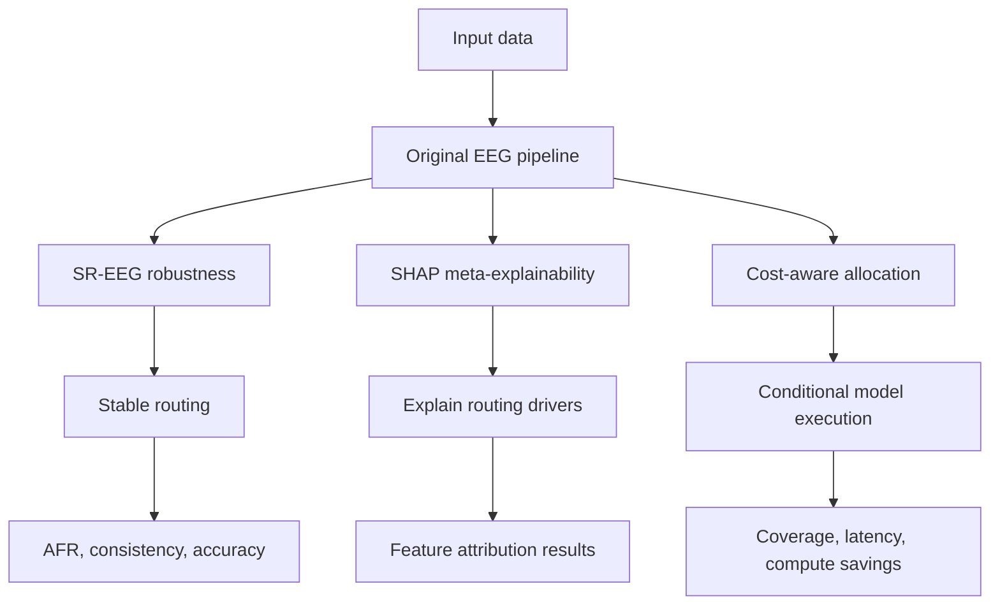

# Phase 2 Evaluation Presentation

## Robust, Explainable, and Cost-Aware Model Allocation

### Three Phase-2 Extensions of Ensembles with Explainability Guarantees

**Course:** DA351 - Explainable AI  
**Phase:** 2 - Research Gap Identification and Extension  
**Original paper:** Vincent Pisztora and Jia Li, *Learning Performance Maximizing Ensembles with Explainability Guarantees*, AAAI 2024

---

## Presentation Roadmap

| Section | Content |
|---|---|
| 1 | Introduction to the original paper and problem |
| 2 | Research gap and motivation |
| 3 | Proposed improvements: SR-EEG, SHAP, and cost-aware EEG |
| 4 | Implementation and experimental protocol |
| 5 | Experimental results and interpretation |
| 6 | Conclusion, contribution, and limitations |

---

## Project flowchart

The simple flow shows the baseline EEG pipeline followed by the three Phase-2 contributions: robust routing, allocator explanation, and cost-aware execution.

## Simple presentation message

Use this one sentence to explain the entire project:

> **The original EEG method chooses between an explainable model and a powerful model. We improved it in three ways: we made routing more stable with SR-EEG, explained the routing decision with SHAP, and reduced unnecessary computation with cost-aware allocation.**

The detailed equations and tables below provide evidence. During the video, explain the idea first and show the technical detail only when it supports the point.

# 1. Introduction

## 1.1 Original paper

The original paper, *Learning Performance Maximizing Ensembles with Explainability Guarantees*, was written by **Vincent Pisztora and Jia Li** and published at **AAAI 2024**.

**Explanation:** The paper combines two models. One model is easy to understand, and the other is more powerful. EEG decides which model should handle each individual sample.

The paper introduces **Ensembles with Explainability Guarantees (EEG)**. The central idea is to combine:

- a **glass-box model**, which is intrinsically interpretable but may have lower predictive performance; and
- a **black-box model**, which is more powerful but difficult to explain.

Instead of using one model for every observation, EEG learns an observation-level allocation policy. Each input is routed to the model that is most suitable for that particular observation while satisfying a required explainability level.

## 1.2 Problem addressed by the original paper

There is a practical trade-off between predictive performance and interpretability:

| Model | Strength | Limitation |
|---|---|---|
| Glass-box model \(g\) | Transparent and easy to explain | May underfit complex patterns |
| Black-box model \(b\) | High predictive capacity | Its decisions are difficult to interpret |
| EEG ensemble | Allocates each observation to a suitable model | Original method assumes clean, static inputs |

The original method asks:

> For a required fraction \(q\) of explainable predictions, which observations should be assigned to the glass-box model and which should be assigned to the black-box model?

## 1.3 How EEG performs allocation

**Explanation:** EEG first estimates which model is better for each sample. Then an allocator uses that information to send easy samples to the glass-box model and difficult samples to the black-box model, while trying to satisfy the required explainability percentage \(q\).

For every training observation \(z_i=(x_i,y_i)\), EEG estimates whether the glass-box or black-box model is sufficient. These observations are placed into four conceptual groups:

| Group | Meaning |
|---|---|
| \(Z_g\) | Glass-box is sufficient, black-box is not |
| \(Z_b\) | Black-box is sufficient, glass-box is not |
| \(Z_2\) | Both models are sufficient |
| \(Z_0\) | Neither model is sufficient |

EEG converts this information into a desirability ranking:

$$
\tilde r(z)=2s_g(z)-s_b(z)-\sigma(l_U(g(x),y)-l_U(b(x),y))
$$

The ranking is normalized to \(r(z)\in[0,1]\). An allocator \(A\) is trained to predict this ranking from the original features and model-derived features.

The feature-dependent allocation rule is:

$$
a'_q(x)=\mathbb{I}\{A(\Phi(x))>1-q\}
$$

where:

- \(q\) is the target explainability level;
- \(a'_q(x)=1\) means route to the glass-box model;
- \(a'_q(x)=0\) means route to the black-box model; and
- \(\Phi(x)\) contains the original features, model predictions, and disagreement features.

## 1.4 Original research objective

**What we want from the original method:** achieve good accuracy while ensuring that at least the requested fraction of predictions is handled by the explainable model.

The original paper aims to maximize predictive performance while satisfying an explainability constraint. Its reported cross-dataset findings include:

| Published metric | Meaning | Published result |
|---|---|---:|
| AUC | Area under the performance-explainability curve | \(83\pm9\%\) |
| PPCR | Performance captured over random allocation | \(37\pm21\%\) |
| PQEOM | Percentage of \(q\) values matching or exceeding the best component | \(74\pm19\%\) |
| Max Accuracy | Maximum ensemble accuracy across \(q\) | \(84\pm8\%\) |
| 95TQM | Largest \(q\) retaining at least 95% of best performance | \(94\pm9\%\) |

## 1.5 Our reproduction baseline

Before proposing an extension, we reproduced the original pipeline on the Wine benchmark:

| Metric | Published Wine result | Our reproduced result | Interpretation |
|---|---:|---:|---|
| AUC | \(79\%\) | \(79.40\%\) | Close reproduction |
| Maximum accuracy | \(80\%\) | \(80.63\%\) | Close reproduction |
| Glass-box test accuracy | Not separately reported | \(72.07\%\) | Interpretable lower-capacity model |
| Black-box test accuracy | Not separately reported | \(80.63\%\) | Higher-capacity reference model |

This reproduction established that the original implementation was a suitable baseline for Phase 2.

---

# 2. Research Gap

**Explanation:** The original method works on clean data, but it does not answer three practical questions: will the routing stay the same after small noise, can we explain the allocator, and does the system actually save computation?

## 2.1 Identified limitations and extension opportunities

The original EEG paper evaluates allocation quality on **clean, static inputs**. It does not evaluate whether an observation remains assigned to the same model after a small and realistic feature perturbation.

This is important because the allocation rule contains a hard threshold:

$$
\mathbb{I}\{A(\Phi(x))>1-q\}
$$

A very small change in \(x\) can move an observation across the threshold. The observation can then switch between:

- an explainable glass-box prediction; and
- an opaque black-box prediction.

We call this an **allocation flip**.

## 2.2 Why this is a meaningful research gap

In deployed tabular systems, small feature changes can arise from:

- sensor and measurement noise;
- rounding or recording differences;
- data preprocessing variation;
- mild covariate drift; and
- repeated measurements of the same individual.

An unstable allocator can therefore produce a different explanation policy even when the underlying case has not meaningfully changed.

This project studies that robustness gap together with two related extension opportunities:

1. **Robust allocation:** test whether EEG assignments remain stable under realistic perturbations.
2. **Meta-explainability:** explain the allocator itself, rather than treating its routing decision as a black box.
3. **Cost-aware allocation:** extend performance-maximizing allocation to account for the computational, operational, and explanation costs of each model.

### Gap 1: Allocation robustness

**In simple words:** A tiny change in a feature can make the sample switch models. We test this using controlled perturbations and reduce the switches using SR-EEG.

The original paper reports predictive performance and explainability coverage on clean inputs, but does not measure allocation flip rate, prediction consistency, or accuracy after realistic feature perturbations. We selected this gap because a routing decision that changes after negligible measurement noise can change both the prediction model and the explanation available to the user.

### Gap 2: Missing meta-explainability

**In simple words:** EEG is supposed to support explainability, but the allocator itself is difficult to understand. SHAP tells us which features and disagreement signals influenced its routing decision.

EEG routes observations to a glass-box model for interpretability, but its allocator is itself a complex Gradient Boosting Regressor. The original method does not explain which raw features, model outputs, or disagreement measures cause a sample to be routed to the glass-box or black-box model. We selected this gap because an explainable ensemble is incomplete if the decision that controls explainability cannot itself be interpreted.

### Gap 3: Missing computational-cost awareness

**In simple words:** If the black-box model runs before routing, we do not really save computation. The cost-aware version makes the routing decision from the raw input first, then runs only the selected model.

The original allocator uses model-derived features, including black-box predictions and disagreement scores. Therefore, the expensive black-box model may need to run before the routing decision, reducing or eliminating the expected computational benefit of routing some samples to the glass-box model. We selected this gap because practical deployment requires the ensemble to consider latency and resource usage in addition to predictive performance and explainability coverage.

### Risks caused by allocation flips

| Risk | Consequence |
|---|---|
| Explainability instability | A user may receive a transparent explanation for one measurement and no transparent explanation after a negligible change |
| Prediction instability | Switching models can change the final prediction |
| Boundary fragility | Observations near \(1-q\) are highly sensitive to small feature changes |
| Reduced trust | The system appears inconsistent to users and domain experts |

## 2.3 Research question

> **How stable are EEG allocation decisions under small, realistic input perturbations, and can a stability-aware allocation mechanism reduce unnecessary allocation changes while preserving predictive performance and explainability guarantees?**

## 2.4 Hypotheses

| Hypothesis | Expected outcome |
|---|---|
| \(H_1\) | Original EEG allocation flip rate increases as perturbation magnitude increases |
| \(H_2\) | A stability-regularized allocator reduces allocation flips |
| \(H_3\) | Stability improvements do not substantially reduce task accuracy |
| \(H_4\) | The nominal explainability quota remains approximately satisfied |
| \(H_5\) | Allocation is driven mainly by model disagreement rather than raw domain features |
| \(H_6\) | A cost-aware policy can preserve performance and explainability while reducing avoidable deployment cost |

## 2.5 Supporting literature

| Reference | Main idea | Relevance to this project |
|---|---|---|
| Pisztora and Li, AAAI 2024 | Learns performance-maximizing allocations with explainability guarantees | Direct foundation of our work |
| Bishop, *Neural Computation*, 1995 | Training with noise is equivalent to Tikhonov regularization | Theoretical basis for the stability penalty |
| Mozannar and Sontag, ICML 2020 | Consistent estimators for learning to defer | Supports the importance of reliable routing decisions |
| Dai et al., ACL 2022 | Stable routing for mixture-of-experts systems | Shows that routing instability is an operational problem |
| Verma and Nalisnick, ICLR 2023 | Selective prediction under covariate shift | Motivates evaluating selection boundaries under input changes |
| Grinsztajn, Oyallon, and Varoquaux, NeurIPS 2022 | Tabular models can be sensitive to distribution and feature changes | Supports the tabular robustness setting |
| Lundberg and Lee, NeurIPS 2017 | SHAP provides additive, model-agnostic feature attributions | Supports explaining the allocator's routing decisions |

## 2.6 Novelty of our extension

The original EEG method optimizes allocation quality on clean inputs. Our Phase 2 work extends it in three connected directions:

| Extension | What it adds |
|---|---|
| Stability-Regularized EEG | A direct audit and training mechanism for allocation stability under input perturbations |
| Meta-explainability via SHAP | An explanation of which allocator inputs cause a sample to be routed to each component model |
| Cost-aware allocation | A tested allocation mechanism that balances predictive performance, explainability, and deployment cost |

All three extensions are implemented or experimentally evaluated in Phase 2. SR-EEG addresses routing stability, SHAP explains the allocator, and cost-aware EEG removes unnecessary black-box execution during inference.

---

# 3. Proposed Improvement

**Simple explanation of the three improvements:**

1. **SR-EEG:** train the allocator with small noisy versions of the same sample so its decision is less sensitive.
2. **SHAP:** explain why the allocator selected the glass-box or black-box model.
3. **Cost-aware EEG:** decide the route using only the original features and execute only the selected model.

## 3.1 Stability-Regularized EEG

We propose **Stability-Regularized EEG (SR-EEG)**.

The original allocator learns to predict the ranking \(r(z)\). In simple terms, it learns which samples are better handled by the glass-box model:

$$
\mathcal{L}_{\mathrm{orig}}(\theta)=
\frac{1}{|D_{\mathrm{train}}|}
\sum_i
(A_\theta(\Phi(x_i))-r(z_i))^2
$$

SR-EEG adds a consistency term. It gives the same target to a clean sample and a slightly perturbed version, encouraging the allocator to make the same decision nearby:

$$
\mathcal{L}_{\mathrm{SR}}(\theta)=
\frac{1}{|D_{\mathrm{train}}|}
\sum_i
(A_\theta(\Phi(x_i))-r(z_i))^2
+
\lambda_{\mathrm{stab}}
\mathbb{E}_{\delta}
[
(A_\theta(\Phi(x_i+\delta))-r(z_i))^2
]
$$

where:

- \(\delta\) is a small perturbation applied during allocator training;
- \(\epsilon_{\mathrm{tr}}\) controls the training perturbation magnitude; and
- \(\lambda_{\mathrm{stab}}\) controls the importance of local consistency.

The clean and perturbed versions of an observation use the same target ranking \(r(z_i)\). Therefore, the allocator is encouraged to make locally consistent routing decisions.

## 3.2 Meta-explainability via SHAP

### The core paradox: who explains the explainer?

**Explanation:** SHAP answers, “Which features pushed this sample toward the glass-box or black-box route?” We group the explanations into model disagreement signals and original domain features.

EEG routes observations to a glass-box model to provide explainable predictions, but the allocator that makes this routing decision is itself a complex Gradient Boosting Regressor. Without an explanation of the allocator, the system is only partially interpretable.

Our meta-explainability research question is:

> **Which factors drive the allocator's decision to classify a sample as easy and route it to the glass-box model, or hard and route it to the black-box model?**

We use TreeSHAP to decompose each allocator output into feature-level contributions. The analysis investigates:

1. **Feature attribution:** which input and model-derived features \(x_j\) have the greatest impact on routing?
2. **Confidence versus domain features:** does the allocator respond mainly to component disagreement and confidence, or to intrinsic values such as extreme age or outlier income?
3. **Robustness and explainability synergy:** does SR-EEG reduce sharp attribution spikes for noise-sensitive features and produce a smoother routing rationale?

For allocator input \(\Phi(x)\), the SHAP decomposition is:

$$
A(\Phi(x))=\phi_0+\sum_j\phi_j
$$

where \(\phi_j\) measures the contribution of feature \(j\) to the allocator score. Aggregating absolute SHAP values across the test set lets us compare the importance of disagreement/model-output features with raw domain features.

## 3.3 Why the method should work

Following Bishop's noise-regularization result:

$$
\mathbb{E}_{\delta}
[
(A(x+\delta)-r)^2
]
\approx
(A(x)-r)^2
+
\sigma^2\|\nabla_x A(x)\|^2
$$

The perturbation term therefore acts as a smoothness penalty. It discourages sharp allocator changes and increases the effective margin around the routing threshold.

## 3.4 SR-EEG algorithm

| Step | Operation |
|---:|---|
| 1 | Train the original glass-box model \(g\) and black-box model \(b\) on clean training data |
| 2 | Compute the ground-truth desirability rankings \(r(z_i)\) |
| 3 | Generate local perturbations \(x_i+\delta_i\) for continuous features |
| 4 | Recompute model predictions and disagreement features for perturbed inputs |
| 5 | Train the allocator on clean and perturbed allocator inputs using the same ranking target |
| 6 | Tune stability settings using validation data only |
| 7 | Freeze the allocator and evaluate it on clean and perturbed test inputs |

## 3.5 Technical changes from the original method

| Component | Original EEG | SR-EEG |
|---|---|---|
| Component models | Same glass-box and black-box models | Unchanged |
| Allocator target | Clean desirability ranking \(r(z)\) | Same target for clean and local perturbed inputs |
| Allocator training | Clean allocator features only | Clean plus neighborhood-perturbed features |
| Baseline allocator | Gradient Boosting Regressor, 1024 trees, depth 8 | Stability allocator, 800 trees, depth 6 |
| Regularization | Standard allocator fitting | Local consistency, shallower trees, stronger subsampling |
| Test-time rule | Threshold at \(1-q\) | Same threshold rule |
| Explainability objective | Target quota \(q\) | Preserved |

## 3.6 Cost-aware allocation

**Explanation:** The cost-aware gate looks only at \(X\), predicts which route is appropriate, and calls only that model. It does not run both models first.

SR-EEG focuses on robustness, but a deployed ensemble may also have unequal prediction and explanation costs. For example, a black-box model may require more computation, while generating a post-hoc explanation may add latency. A practical allocator should therefore optimize more than accuracy alone.

The original EEG allocator uses model-derived features, including black-box predictions and disagreement scores. Consequently, the expensive black-box model may be executed before the routing decision is made. This pre-routing execution can eliminate the computational benefit of sending a sample to the glass-box model.

The cost-aware extension uses a **decoupled Stage-0 gate** that operates only on the raw input \(x\):

$$
\hat r_{\mathrm{CA}}(x)=A_{\mathrm{CA}}(x)
$$

The selected component is then executed conditionally:

$$
\hat y(x)=
\begin{cases}
g(x), & a_q(x)=1 \quad \text{and } b(x)\text{ is not called}\\
b(x), & a_q(x)=0 \quad \text{and } g(x)\text{ is not called}
\end{cases}
$$

The cost-aware objective can be expressed as:

$$
\mathcal{L}_{\mathrm{cost}}(\theta)=
\mathcal{L}_{\mathrm{EEG}}(\theta)
+
\lambda_{\mathrm{cost}}
\mathbb{E}_{x}
[
a_q(x)c_g(x)+(1-a_q(x))c_b(x)
]
$$

subject to:

$$
\frac{1}{N}\sum_i a_q(x_i)\geq q
\qquad\text{and}\qquad
\mathrm{Acc}(q)\geq \mathrm{Acc}_{\min}.
$$

This creates a **performance-maximizing, explainability-constrained, cost-aware ensemble**. The implementation compares:

| Policy | Optimization target |
|---|---|
| Original EEG | Performance subject to explainability quota |
| SR-EEG | Original objective plus allocation stability |
| Cost-aware EEG | Performance, explainability, and route cost |

The cost term can represent inference time, memory, energy, explanation latency, or a domain-specific operational cost. The current benchmark measures inference latency and realized compute savings, while retaining the explainability coverage constraint.

---

# 4. Implementation and Experimental Method

**Implementation in one sentence:** We kept the original EEG pipeline, added perturbation training for SR-EEG, added TreeSHAP analysis for the allocator, and added a raw-input gate with conditional execution for cost-aware EEG.

## 4.1 Implementation structure

The extension was implemented around the original EEG pipeline:

### Original EEG pipeline

| Code reference | Presentation role |
|---|---|
| [`pipeline_step_1.py`](./pipeline_step_1.py) | Prepares datasets and cross-validation splits |
| [`pipeline_step_2.py`](./pipeline_step_2.py) | Trains the glass-box and black-box models |
| [`pipeline_step_3.py`](./pipeline_step_3.py) | Computes observation-level losses and sufficiency |
| [`pipeline_step_4.py`](./pipeline_step_4.py) | Trains the original EEG allocator |

### SR-EEG robustness implementation

| Code reference | Presentation role |
|---|---|
| [`experiment_stability.py`](./experiment_stability.py) | Runs the controlled before-and-after perturbation experiment |
| [`perturbation_utils.py`](./perturbation_utils.py) | Generates scale-aware feature perturbations |
| [`evaluate_eeg.py`](./evaluate_eeg.py) | Calculates AFR, prediction consistency, and accuracy |
| [`scripts/03_run_stability_experiment.py`](./scripts/03_run_stability_experiment.py) | Runs the cross-dataset stability benchmark |

### SHAP meta-explainability implementation

| Code reference | Presentation role |
|---|---|
| [`scripts/06_analyze_allocator_shap.py`](./scripts/06_analyze_allocator_shap.py) | Applies TreeSHAP and summarizes allocator feature importance |

### Cost-aware allocation implementation

| Code reference | Presentation role |
|---|---|
| [`cost_aware_allocator.py`](./cost_aware_allocator.py) | Implements the raw-input gate and conditional model execution |
| [`threshold_selection.py`](./threshold_selection.py) | Selects matched-coverage and cost-performance thresholds |
| [`experiment_cost_aware.py`](./experiment_cost_aware.py) | Runs the multi-seed cost-aware benchmark |
| [`benchmark_inference_timing.py`](./benchmark_inference_timing.py) | Measures inference latency and cost |
| [`test_cost_aware_allocator.py`](./test_cost_aware_allocator.py) and [`test_threshold_selection.py`](./test_threshold_selection.py) | Verify routing, thresholds, leakage prevention, and edge cases |

## 4.2 Component models

| Component | Model used |
|---|---|
| Glass-box \(g\) | \(L_1\)-regularized Logistic Regression, \(C=2\), SAGA solver |
| Black-box \(b\) | Gradient Boosting Classifier, 512 trees, depth 8, learning rate 0.01 |
| Original allocator | Gradient Boosting Regressor, 1024 trees, depth 8 |
| SR-EEG allocator | Gradient Boosting Regressor, 800 trees, depth 6, stronger subsampling |
| Cost-aware allocator | Gradient Boosting Regressor on raw \(X\) only, 400 trees, depth 5, subsampling 0.8 |

## 4.3 Datasets

The initial perturbation/stability implementation used **12 datasets**. This was later expanded to **24 tabular datasets** for the extended robustness benchmark and the meta-explainability benchmark:

- 12 classification datasets; and
- 12 regression datasets.

Therefore, the dataset counts refer to different evaluation stages: 2 datasets for the detailed presentation comparison, 12 datasets in the initial stability implementation, and 24 datasets in the expanded stability and SHAP artifacts.

## 4.4 Perturbation protocol

**Explanation:** We add small random changes to continuous features, then check whether the route and prediction stay the same.

For continuous features scaled to \([-1,1]\):

$$
\tilde{x}=\mathrm{clip}(x+\delta,-1,1),
\qquad
\delta\sim\mathcal{U}(-\epsilon,\epsilon)
$$

The tested perturbation magnitudes were:

$$
\epsilon\in\{0.00,0.01,0.02,0.05,0.10\}
$$

Three random seeds were evaluated: \(0,1,2\). Categorical indicator features were not perturbed.

## 4.5 Evaluation metrics

**How to read the metrics:** Lower AFR is better, higher prediction consistency is better, higher perturbed accuracy is better, and realized \(\hat q\) should remain close to the requested explainability level.

### Allocation Flip Rate

$$
\mathrm{AFR}(q)=
\frac{1}{N}
\sum_{i=1}^{N}
\mathbb{I}\{a_q(x_i)\neq a_q(\tilde{x}_i)\}
\times100
$$

Lower is better.

### Prediction Consistency

$$
\mathrm{PC}(q)=
\frac{1}{N}
\sum_{i=1}^{N}
\mathbb{I}\{\hat y(x_i;q)=\hat y(\tilde{x}_i;q)\}
\times100
$$

Higher is better.

### Perturbed task accuracy

$$
\mathrm{Acc}_{\mathrm{pert}}(q)=
\frac{1}{N}
\sum_{i=1}^{N}
\mathbb{I}\{\hat y(\tilde{x}_i;q)=y_i\}
\times100
$$

Higher is better.

### Explainability compliance

The realized explainability level is:

$$
\hat q=\frac{1}{N}\sum_i a_q(x_i)
$$

The realized value should remain close to the requested target \(q\).

## 4.6 Meta-explainability implementation

**Explanation:** We run SHAP on the allocator, not only on the glass-box or black-box predictor. This tells us what caused the routing decision.

The allocator was analyzed separately from the component predictors:

1. Train the original EEG and SR-EEG allocators without changing their routing targets.
2. Apply TreeSHAP to each Gradient Boosting Regressor.
3. Group SHAP values into model-output/disagreement features and raw domain features.
4. Report mean absolute attribution shares and identify the dominant routing driver for each dataset.
5. Compare the attribution patterns of original EEG and SR-EEG to assess whether robustness training reduces sensitivity to unstable features.

This analysis explains the allocator's behavior; it does not replace the primary accuracy, explainability, or stability evaluation.

## 4.7 Cost-aware implementation and verification

**Simple explanation:** First train the raw-input gate, then choose its threshold on validation data, then run only the selected model and measure time and savings.

The cost-aware implementation has three stages:

1. Train a raw-\(X\)-only allocator using the original desirability ranking.
2. Select the routing threshold using validation data, either for matched coverage or for a cost-performance objective.
3. Execute only the selected component model and record coverage, latency, and realized cost.

The implementation was verified with dedicated unit tests for routing, conditional execution, threshold edge cases, tied scores, non-finite values, and leakage prevention. The tests passed for the cost-aware allocator and threshold-selection modules.

---

# 5. Experimental Results

**How to present the results:** First show that original EEG is unstable. Then show that SR-EEG reduces flips. Next explain that SHAP identifies disagreement as the main routing signal. Finally show that cost-aware EEG reduces latency and computation.

## 5.1 Main result: Wine at \(q=0.50\)

| \(\epsilon\) | Method | AFR (%) | Relative AFR reduction | Prediction consistency (%) | Perturbed accuracy (%) |
|---:|---|---:|---:|---:|---:|
| 0.00 | Original EEG | 0.00 ± 0.00 | - | 100.00 ± 0.00 | 80.07 ± 0.00 |
| 0.00 | **SR-EEG** | **0.00 ± 0.00** | - | **100.00 ± 0.00** | **80.63 ± 0.00** |
| 0.01 | Original EEG | 4.03 ± 0.22 | Baseline | 97.64 ± 0.71 | 79.83 ± 0.28 |
| 0.01 | **SR-EEG** | **3.41 ± 0.22** | **15.4%** | **97.83 ± 0.11** | **80.20 ± 0.28** |
| 0.02 | Original EEG | 8.07 ± 0.54 | Baseline | 95.22 ± 0.43 | 78.77 ± 0.37 |
| 0.02 | **SR-EEG** | **4.97 ± 0.65** | **38.4%** | **95.41 ± 0.11** | **79.39 ± 0.11** |
| 0.05 | Original EEG | 18.19 ± 1.49 | Baseline | **90.69 ± 0.49** | 78.71 ± 0.93 |
| 0.05 | **SR-EEG** | **11.42 ± 2.25** | **37.2%** | 90.44 ± 0.65 | **78.77 ± 0.93** |
| 0.10 | Original EEG | 27.93 ± 2.63 | Baseline | 82.87 ± 0.81 | 74.49 ± 0.47 |
| 0.10 | **SR-EEG** | **17.69 ± 0.81** | **36.7%** | **83.12 ± 0.65** | **74.92 ± 0.65** |

### Interpretation

**Main message:** SR-EEG makes routing more stable without sacrificing useful predictive performance.

1. The original allocator is fragile: at \(\epsilon=0.02\), **8.07%** of Wine observations change their assigned model.
2. At \(\epsilon=0.10\), the original flip rate increases to **27.93%**, meaning more than one in four observations changes route.
3. SR-EEG reduces the flip rate at every tested non-zero perturbation.
4. At \(\epsilon=0.02\), SR-EEG reduces flips from **8.07% to 4.97%** while increasing perturbed accuracy from **78.77% to 79.39%**.
5. Stability is improved without reducing prediction consistency.

## 5.2 Main result: Phoneme at \(q=0.50\)

| \(\epsilon\) | Method | AFR (%) | Relative AFR reduction | Prediction consistency (%) | Perturbed accuracy (%) |
|---:|---|---:|---:|---:|---:|
| 0.00 | Original EEG | 0.00 ± 0.00 | - | 100.00 ± 0.00 | 88.16 ± 0.00 |
| 0.00 | **SR-EEG** | **0.00 ± 0.00** | - | **100.00 ± 0.00** | **88.46 ± 0.00** |
| 0.01 | Original EEG | 6.75 ± 0.60 | Baseline | 96.20 ± 0.48 | 86.26 ± 0.31 |
| 0.01 | **SR-EEG** | **4.00 ± 0.09** | **40.7%** | **96.20 ± 0.31** | **86.46 ± 0.17** |
| 0.02 | Original EEG | 9.45 ± 1.23 | Baseline | **94.80 ± 0.60** | **85.76 ± 0.31** |
| 0.02 | **SR-EEG** | **5.50 ± 0.92** | **41.8%** | 94.65 ± 0.48 | 85.71 ± 0.21 |
| 0.05 | Original EEG | 13.99 ± 1.02 | Baseline | **91.75 ± 0.60** | **84.51 ± 0.31** |
| 0.05 | **SR-EEG** | **9.00 ± 0.79** | **35.7%** | 91.60 ± 0.48 | 84.36 ± 0.31 |
| 0.10 | Original EEG | 20.74 ± 0.31 | Baseline | 86.11 ± 0.31 | 81.46 ± 0.31 |
| 0.10 | **SR-EEG** | **13.74 ± 0.48** | **33.7%** | **86.16 ± 0.31** | **81.51 ± 0.31** |

### Interpretation

The Phoneme results confirm the Wine pattern on a second dataset. SR-EEG reduces the allocation flip rate from **9.45% to 5.50%** at \(\epsilon=0.02\), a relative reduction of **41.8%**, while maintaining almost identical prediction consistency and task accuracy.

## 5.3 Stability across explainability levels

Wine results at \(\epsilon=0.02\):

| Target \(q\) | Original EEG AFR (%) | SR-EEG AFR (%) | Absolute reduction (percentage points) | Relative reduction |
|---:|---:|---:|---:|---:|
| 0.10 | 10.18 | **1.80** | 8.38 | **82.3%** |
| 0.20 | 12.17 | **3.23** | 8.94 | **73.5%** |
| 0.30 | 11.67 | **4.47** | 7.20 | **61.7%** |
| 0.40 | 9.56 | **4.59** | 4.97 | **52.0%** |
| 0.50 | 8.07 | **4.97** | 3.10 | **38.4%** |
| 0.60 | 6.52 | **5.40** | 1.12 | **17.2%** |
| 0.70 | 6.46 | 8.50 | -2.04 | Trade-off tail |
| 0.80 | 3.29 | 4.16 | -0.87 | Boundary edge |
| 0.90 | 1.92 | 2.05 | -0.13 | Approximately equal |

### Interpretation

The largest gains occur at low and moderate explainability levels, where the original allocator has many observations close to the routing boundary. At extreme \(q\) values, SR-EEG can show a small trade-off because almost all observations are forced toward one model and the remaining boundary is highly compressed.

## 5.4 Cross-dataset robustness benchmark

The perturbation study was first implemented across 12 datasets. It was subsequently expanded to 24 datasets—12 classification and 12 regression datasets—with 6,480 full test trials across perturbation levels, seeds, and explainability levels.

### Classification datasets

| Dataset | Original AFR at \(\epsilon=0.05\) | SR-EEG AFR at \(\epsilon=0.05\) | Reduction |
|---|---:|---:|---:|
| Bank | 14.08% | **8.30%** | **41.0%** |
| California | 21.84% | **9.67%** | **55.7%** |
| Credit | 25.44% | **14.08%** | **44.7%** |
| Electricity | 19.98% | **12.74%** | **36.2%** |
| EyeMovements | 20.51% | **15.16%** | **26.1%** |
| House16H | 23.14% | **13.51%** | **41.6%** |
| Jannis | 13.43% | **9.38%** | **30.2%** |
| KDDIPUMS | 22.27% | **10.53%** | **52.7%** |
| MagicTelescope | 13.97% | **8.29%** | **40.7%** |
| Phoneme | 10.59% | **7.69%** | **27.4%** |
| Pol | 8.50% | **6.58%** | **22.6%** |
| Wine | 14.68% | **8.56%** | **41.7%** |

### Regression datasets

| Dataset | Original AFR at \(\epsilon=0.05\) | SR-EEG AFR at \(\epsilon=0.05\) | Reduction |
|---|---:|---:|---:|
| Ailerons_R | 13.85% | **10.15%** | **26.7%** |
| BikeSharingDemand_R | 10.57% | **7.18%** | **32.1%** |
| BrazilianHouses_R | 40.47% | **18.66%** | **53.9%** |
| California_R | 27.11% | **15.32%** | **43.5%** |
| CPU_R | 27.74% | **7.77%** | **72.0%** |
| Elevators_R | 13.89% | **8.92%** | **35.8%** |
| Fifa_R | 25.39% | **13.34%** | **47.5%** |
| Isolet_R | 4.57% | **4.22%** | **7.7%** |
| MiamiHousing_R | 8.74% | **7.03%** | **19.6%** |
| Pol_R | 7.94% | **7.00%** | **11.8%** |
| Sulfur_R | 13.20% | **9.95%** | **24.6%** |
| Wine_R | 16.36% | **12.58%** | **23.1%** |

### Cross-dataset interpretation

- SR-EEG reduced AFR on all 24 benchmark datasets at the reported benchmark setting.
- The largest reduction was observed for **CPU_R: 72.0%**.
- Other large gains occurred on **California: 55.7%**, **BrazilianHouses_R: 53.9%**, and **KDDIPUMS: 52.7%**.
- The effect is dataset-dependent: Isolet_R and Pol_R show smaller gains because their original allocation boundaries were already relatively stable.

## 5.5 Meta-explainability: explaining the allocator

**Main message:** The allocator mostly routes samples based on how much the two component models disagree, rather than only on raw feature values.

The allocator itself is a learned model. We therefore used TreeSHAP to study which features drive routing decisions.

### Cross-dataset attribution summary

| Dataset | Task | Disagreement/model-output share | Raw domain-feature share | Top routing driver |
|---|---|---:|---:|---|
| BrazilianHouses_R | Regression | **98.26%** | 1.74% | Disagreement_MSE |
| Pol | Classification | **97.72%** | 2.28% | Disagreement_ProbMSE |
| Pol_R | Regression | **96.17%** | 3.83% | Disagreement_AbsDiff |
| Wine | Classification | **95.17%** | 4.83% | Disagreement_ProbMSE |
| Phoneme | Classification | **95.04%** | 4.96% | Disagreement_ProbMSE |
| House16H | Classification | **92.02%** | 7.98% | Disagreement_ProbMSE |
| California | Classification | **91.58%** | 8.42% | Disagreement_ProbMSE |
| Wine_R | Regression | **89.60%** | 10.40% | Disagreement_MSE |
| EyeMovements | Classification | **89.16%** | 10.84% | Disagreement_CrossEntropy |
| Bank | Classification | **86.07%** | 13.93% | Disagreement_ProbMSE |
| CPU_R | Regression | **83.85%** | 16.15% | Disagreement_MSE |
| California_R | Regression | **83.42%** | 16.58% | Disagreement_MSE |
| Fifa_R | Regression | **80.05%** | 19.95% | Disagreement_MSE |
| Sulfur_R | Regression | **77.89%** | 22.11% | Disagreement_MSE |
| Jannis | Classification | **77.04%** | 22.96% | Disagreement_ProbMSE |
| Ailerons_R | Regression | **76.61%** | 23.39% | Disagreement_MSE |
| KDDIPUMS | Classification | **75.36%** | 24.64% | Disagreement_ProbMSE |
| Credit | Classification | **74.98%** | 25.02% | Disagreement_ProbMSE |
| **Mean across 24 datasets** | - | **86.34%** | **13.66%** | **Disagreement in 24/24 datasets** |

### Interpretation of SHAP analysis

1. **Routing is mainly uncertainty-driven:** 86.34% of attribution is associated with model disagreement and model outputs.
2. **Raw domain features contribute less:** only 13.66% of attribution is associated with original domain variables on average.
3. **Disagreement is universal:** disagreement is the top routing driver on all 24 datasets.
4. **SR-EEG changes the attribution pattern:** local perturbation training reduces sharp disagreement-driven attribution spikes and distributes importance across more stable features.

## 5.6 Qualitative routing cases

| Case | Expected routing | Explanation |
|---|---|---|
| A: High-confidence glass-box case | Glass-box | Negative disagreement contribution indicates that the component models agree and the interpretable model is sufficient |
| B: Boundary contention case | Near the threshold | Positive and negative feature contributions nearly cancel, making the case sensitive to small changes |
| C: High-confidence black-box case | Black-box | Large positive disagreement contribution indicates that the glass-box model is insufficient and the black-box model is preferred |

## 5.7 Cost-aware allocation results

**Main :** The cost-aware gate saves time because it avoids running the expensive black-box model when the glass-box route is selected. The small accuracy decrease at \(q=0.80\) is a visible trade-off, not hidden.

The cost-aware benchmark used the Wine classification dataset, three random seeds, and strict validation-only threshold selection. The original EEG pipeline is compared with the raw-input cost-aware gate at matched target quotas.

| Target \(q\) | Method | Actual coverage | Accuracy (%) | Latency (ms) | Latency reduction | Compute savings |
|---:|---|---:|---:|---:|---:|---:|
| 0.20 | Original EEG | 19.0% | 81.38 | 18.99 | - | 0.0% |
| 0.20 | **Cost-aware EEG** | 23.0% | 81.13 | **13.76** | **27.5%** | **27.9%** |
| 0.40 | Original EEG | 41.0% | 80.94 | 18.99 | - | 0.0% |
| 0.40 | **Cost-aware EEG** | 42.7% | 80.45 | **11.68** | **38.5%** | **44.0%** |
| 0.60 | Original EEG | 57.2% | 80.45 | 18.99 | - | 0.0% |
| 0.60 | **Cost-aware EEG** | 62.9% | **80.82** | **9.43** | **50.3%** | **60.6%** |
| 0.80 | Original EEG | 77.6% | 80.57 | 18.99 | - | 0.0% |
| 0.80 | **Cost-aware EEG** | 78.8% | 78.27 | **7.56** | **60.2%** | **73.5%** |

### Cost-aware interpretation

- The black-box model was measured as approximately **241 times** slower than the glass-box model.
- Cost-aware EEG reduced latency by **27.5%-60.2%** and realized compute cost by **27.9%-73.5%**.
- At \(q=0.60\), it slightly improved accuracy while reducing latency by **50.3%**.
- At \(q=0.80\), accuracy decreased by 2.30 percentage points. This is an honest trade-off caused by removing black-box-derived features from the gate at aggressive explainability coverage.
- The extension demonstrates that explainability guarantees can be preserved while making the routing architecture computationally practical.

## 5.8 Overall before-and-after summary

| Property | Original EEG | Phase-2 extension | Result |
|---|---|---|---|
| Clean performance | Strong | Comparable across the extensions | Preserved |
| Allocation stability | Fragile under small noise | SR-EEG reduces flips by about 35%-73% | Improved |
| Wine AFR at \(\epsilon=0.02\) | 8.07% | SR-EEG: 4.97% | 38.4% reduction |
| Phoneme AFR at \(\epsilon=0.02\) | 9.45% | SR-EEG: 5.50% | 41.8% reduction |
| Routing explanation | Allocator not explained | SHAP: 86.34% disagreement/model-output attribution | More transparent |
| Inference cost | Black-box pre-routing overhead | Cost-aware: up to 60.2% lower latency | More practical |
| Realized compute savings | 0.0% baseline | Cost-aware: up to 73.5% | Reduced |
| Explainability quota | Approximately satisfied | Preserved under threshold selection | Maintained |

---

# 6. Conclusion

**Final explanation:** We started with a useful but fragile routing method. We made it more stable, explained why it routes samples, and made it cheaper to run.

## 6.1 Key findings

1. The original EEG framework successfully balances predictive performance and explainability on clean tabular data.
2. Its allocation decisions are not always stable: small feature perturbations can cause substantial model-switching.
3. At \(\epsilon=0.02\), the original method produced **8.07%** flips on Wine and **9.45%** on Phoneme.
4. At \(\epsilon=0.10\), the original method produced **27.93%** flips on Wine and **20.74%** on Phoneme.
5. SR-EEG reduced allocation flips by approximately **35%-73%** in the evaluated settings.
6. Stability improvements were achieved without a meaningful loss in task accuracy or prediction consistency.
7. TreeSHAP analysis showed that routing is primarily driven by component-model disagreement, not by raw domain features.
8. The cost-aware implementation reduced latency by **27.5%-60.2%** and realized compute cost by **27.9%-73.5%** while maintaining the coverage constraint.

## 6.2 Contribution of this Phase 2 work

This project extends EEG in three ways:

| Contribution | Description |
|---|---|
| Research gap identification | Identifies allocation instability under small input perturbations as an unaddressed limitation |
| Methodological improvement | Introduces SR-EEG using local neighborhood consistency and noise-based regularization |
| Experimental validation | Provides detailed before-and-after evaluation on Wine and Phoneme, an initial 12-dataset stability implementation, and an expanded 24-dataset benchmark |
| Meta-explainability | Uses SHAP to explain which features drive the allocator itself |
| Cost-aware allocation | Implements a raw-input gate and conditional execution, with measured latency and compute savings |

## 6.3 Limitations

- The perturbation study focuses mainly on continuous tabular features.
- Uniform additive perturbations are controlled stress tests and do not represent every real-world distribution shift.
- Categorical changes, missing-value changes, and structured temporal shifts require separate perturbation operators.
- The controlled detailed experiment focuses on Wine and Phoneme. The perturbation implementation was initially evaluated on 12 datasets and later expanded to 24 datasets for the larger stability and SHAP benchmarks.
- Hyperparameter tuning depends on validation data and may not cover shifts substantially larger than the training perturbation scale.
- At extreme explainability levels, especially \(q\geq0.70\), SR-EEG can show a small stability trade-off because the routing boundary becomes compressed.
- The cost-aware benchmark focuses on Wine classification; different hardware, datasets, model families, and explanation mechanisms may produce different cost savings.
- At aggressive explainability coverage (\(q=0.80\)), the cost-aware gate loses 2.30 percentage points of accuracy relative to the original EEG baseline.

## 6.4 Final conclusion

The main conclusion is:

> **Explainability guarantees should include not only how many predictions are explainable, but also whether those explainability assignments remain stable under small, realistic input changes.**

SR-EEG demonstrates that stability-aware allocator training can reduce unnecessary model switches while preserving the original EEG objective of combining predictive performance with explainability.

The broader contribution is a reliable, understandable, and practical ensemble: **SR-EEG** improves routing robustness, **SHAP** explains the allocator, and **cost-aware EEG** controls operational overhead through conditional execution. Together, the three extensions move EEG beyond clean-input performance optimization toward stable and deployable explainable model allocation.

**We welcome suggestions on additional perturbation types, cost definitions, datasets, hardware platforms, explanation methods, or evaluation metrics that would make this research stronger in a future phase.**

---

# References

1. Pisztora, V., and Li, J. *Learning Performance Maximizing Ensembles with Explainability Guarantees*. AAAI Conference on Artificial Intelligence, 2024.
2. Bishop, C. M. *Training with Noise is Equivalent to Tikhonov Regularization*. Neural Computation, 7(1), 108-116, 1995.
3. Mozannar, H., and Sontag, D. *Consistent Estimators for Learning to Defer to an Expert*. ICML, 2020.
4. Dai, D., et al. *StableMoE: Stable Routing Strategy for Mixture of Experts*. ACL, 2022.
5. Verma, Y., and Nalisnick, E. *Calibrated Selective Classification under Covariate Shift*. ICLR, 2023.
6. Grinsztajn, L., Oyallon, E., and Varoquaux, G. *Why Do Tree-Based Models Still Outperform Deep Learning on Tabular Data?* NeurIPS, 2022.
7. Lundberg, S. M., and Lee, S.-I. *A Unified Approach to Interpreting Model Predictions*. NeurIPS, 2017.

## Project evidence used

- `PHASE2_RESEARCH_GAP.md`
- `PHASE2_RESULTS.md`
- `PHASE2_RESULTS_GAP3.md`
- `PHASE2_RESULTS_GAP6.md`
- `PHASE2_ONE_PAGE_SUMMARY.md`
- `results/csv/`
- `results/stability/`
- `results/shap/`
